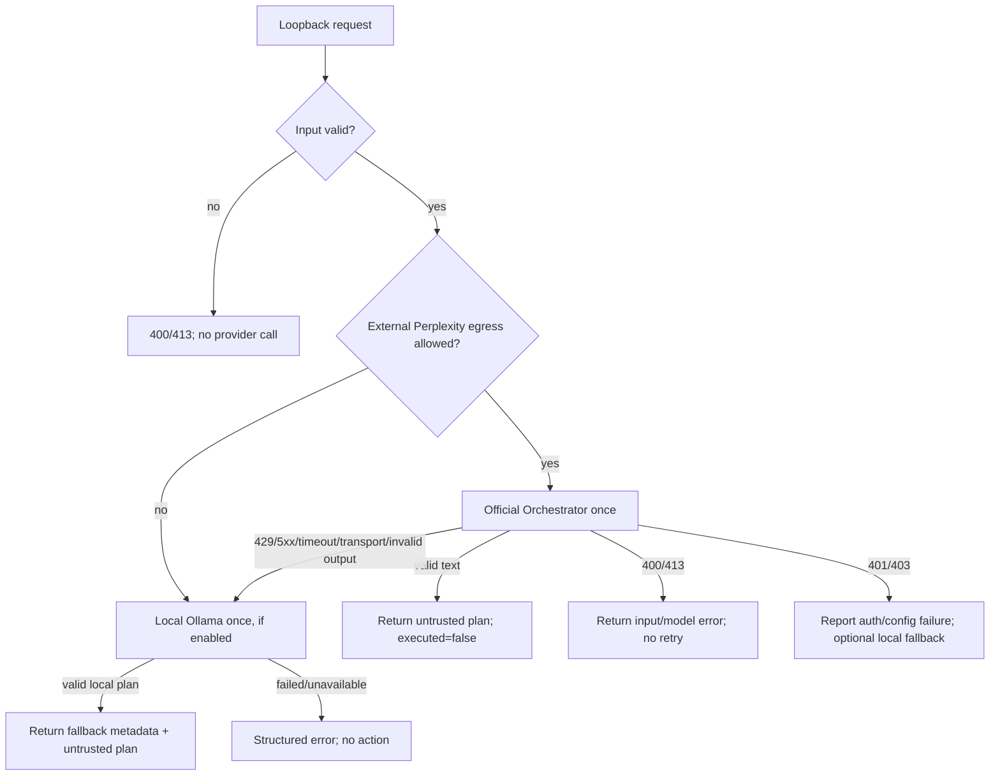

# GNW Computer-task plan route — automatic error handling and fallback design

**Status:** Design specification only. The official Perplexity-backed `POST /v1/computer/plan` exists, but automatic local fallback, circuit breaker, and retry coordinator are not implemented by this document. The existing actual desktop-control route remains unavailable; this design never executes computer actions.

## 1. مقصد اور حفاظتی حد

یہ mechanism صرف task کے لیے **متن پر مبنی، human-review-only plan** بنائے۔ یہ Perplexity Computer، browser automation، shell، plugins یا desktop actions کو نہ چلائے۔ ہر کامیاب جواب میں یہ invariants برقرار رہیں:

- `executed: false`
- `approval_required: true`
- model output کو untrusted سمجھا جائے
- کوئی plan خودکار طور پر click/type/submit/run نہ ہو

موجودہ `/v1/computer/plan` official Perplexity Orchestrator کو task بھیجتا ہے؛ یہ data hosted Perplexity API تک جاتا ہے اور charges ممکن ہیں۔ موجودہ local Ollama planner الگ `127.0.0.1:8011/v1/plan` ہے؛ اسے automatic fallback بنانے کے لیے coordinator integration درکار ہے۔

## 2. مجوزہ service contract

موجودہ direct route برقرار رکھیں اور ایک explicit orchestrator route شامل کریں:

- `POST /v1/computer/plan` — موجودہ direct official Perplexity text route؛ upstream 503 وغیرہ caller کو واپس کرتا ہے۔
- `POST /v1/computer/plan/auto` — مجوزہ coordinator؛ Perplexity primary، local Ollama secondary؛ کبھی action executor نہیں۔
- `POST http://127.0.0.1:8011/v1/plan` — موجودہ local Ollama planner؛ صرف local plan generation۔
- `POST /v1/computer` — 501 برقرار؛ کوئی documented desktop-control API نہیں۔

Coordinator input میں `model`, `task`, اور واضح policy flags ہوں، مثال کے طور پر `allow_perplexity_egress` اور `allow_local_fallback`۔ Unknown fields، arbitrary `url`, `tools`, caller-supplied headers، اور credentials رد ہوں۔ Task length کی موجودہ 4,000-character حد برقرار رہے۔ Sensitive data کے لیے external egress کی اجازت کو LLM خود classify نہ کرے؛ client/operator واضح policy دے۔

## 3. End-to-end flow



## 4. Failure classification اور fallback rules

| صورتِ حال | خودکار ردِعمل | دوبارہ Perplexity call؟ | Local Ollama fallback |
|---|---|---:|---|
| Bad JSON، خالی task، task حد سے بڑا | 400/413 اور واضح input error | نہیں | نہیں؛ پہلے input درست کریں |
| Model/API key configure نہیں | secret یا key ظاہر کیے بغیر config error | نہیں | صرف اگر local fallback policy enabled ہو |
| 401/403 | auth/entitlement alert؛ credentials کبھی log نہ ہوں | نہیں | optional؛ جواب میں primary auth failure واضح رہے |
| 404/400 model/access issue | model ID/catalog کی اصلاح درکار | نہیں | optional؛ model ID خودکار طور پر بدل کر دوبارہ نہ آزمائیں |
| 429 | `Retry-After` کو output میں محفوظ کریں؛ default میں جلد دوبارہ call نہ کریں | default نہیں | enabled ہو تو local ایک مرتبہ |
| 5xx، 502/503/504 یا transport error | provider health failure record کریں | default نہیں | enabled ہو تو local ایک مرتبہ |
| Timeout، جبکہ request accept ہوئی ہو سکتی ہے | outcome ambiguous؛ duplicate charge سے بچیں | نہیں | enabled ہو تو local ایک مرتبہ |
| HTTP 200 مگر empty/invalid text | malformed-output error record کریں | نہیں | enabled ہو تو local ایک مرتبہ |
| Local Ollama missing، remote/cloud model، timeout یا bad JSON | sanitized fallback error؛ recursive retries نہیں | نہیں | ناکامی کے بعد رک جائیں |
| Primary اور fallback دونوں ناکام | structured 503/504؛ دونوں error classes اور request ID | نہیں | ختم؛ کوئی third-party fallback نہیں |

**اہم:** Perplexity POST کے timeout/503 کے بعد خودکار repeat نہ کریں، کیونکہ یہ معلوم نہیں ہوتا کہ پہلی درخواست provider نے process یا bill کی تھی یا نہیں۔ موجودہ official route کوئی verified idempotency contract استعمال نہیں کرتا۔ صرف `Retry-After` header محفوظ رکھیں؛ خودکار retry بعد میں صرف official idempotency support اور واضح call budget کی verification کے بعد شامل ہو۔

## 5. Fallback اور budget policy

1. Default budget فی task: **زیادہ سے زیادہ 1 official Perplexity request + 1 local Ollama request**۔ کوئی swarm، model fan-out، Bedrock fallback، legacy session-scraper fallback، یا hidden endpoint نہیں۔
2. Perplexity task پہلے ہی hosted provider کو بھیجا جا چکا ہو سکتا ہے؛ local fallback egress کو undo نہیں کرتا۔ Response میں `primary_provider`، `fallback_used`، `primary_http_status` اور `data_egress` صاف دکھائیں۔
3. Local fallback تبھی چلائیں جب `allow_local_fallback=true` ہو، Ollama local طور پر reachable ہو، منتخب model `/api/tags` میں exact installed entry ہو، اور entry remote/cloud نہ ہو۔ موجودہ local planner ان model checks کو پہلے ہی کرتا ہے۔
4. Local fallback بند یا unavailable ہو تو اصل upstream status/error محفوظ رکھتے ہوئے structured failure دیں؛ خام provider body، prompt، key یا token ظاہر نہ کریں۔
5. Cost guard: کوئی hidden retry یا fan-out نہیں۔ Caller کے واضح نئے request کے بغیر دوسری Perplexity attempt نہ ہو۔

## 6. Circuit breaker اور timeout budget

Official Orchestrator اور local Ollama کے لیے **الگ breakers** رکھیں؛ existing `ModelRouter` کا default target `127.0.0.1:8000` browser-session bridge ہے، اس لیے اسے براہ راست official port `8010` پر فرضی طور پر لاگو نہ کریں۔ Existing router میں 3-failure threshold اور 60s recovery defaults ہیں، مگر transient 429/503/transport failures consecutive-failure counter نہیں بڑھاتے اور breaker state recovery پوری طرح persisted نہیں ہے۔ Plan route کے breaker کو explicit tests کے ساتھ الگ نافذ کریں:

- Official provider: transport errors اور 5xx کی مسلسل 3 failures/60s پر breaker OPEN؛ 60s cooldown کے بعد صرف ایک HALF_OPEN probe؛ success پر CLOSED۔ 401/403/400 کو circuit-health failure نہ سمجھیں۔ 429 کو Retry-After cooldown/quota state سمجھیں، نہ کہ model-quality failure۔
- Local Ollama: 3 transport/timeout/server failures پر OPEN؛ 30–60s کے بعد ایک probe۔ Missing model یا invalid configuration پر repeated retry نہ کریں۔
- موجودہ upstream timeout 60s ہے؛ local Ollama call 120s تک لے سکتی ہے۔ Coordinator کا مجموعی deadline تقریباً 180s سے زیادہ نہ ہو اور ہر step میں باقی deadline پاس ہو۔
- `/health` صرف process health دے؛ provider network request نہ کرے۔ `/ready` اگر شامل ہو تو key صرف configured/not-configured boolean دے، secret کبھی نہیں۔

## 7. Response shapes

کامیاب primary یا fallback دونوں کی outer shape یکساں رہے:

```json
{
  "mode": "computer_task_plan_only",
  "status": "pending_human_review",
  "executed": false,
  "approval_required": true,
  "untrusted_model_output": true,
  "primary_provider": "perplexity-orchestrator",
  "primary_http_status": 503,
  "fallback_used": "ollama-local",
  "plan_text": "..."
}
```

Primary اور fallback دونوں ناکام ہوں:

```json
{
  "error": {
    "code": "plan_service_unavailable",
    "message": "No plan provider is currently available. No computer action was performed."
  },
  "request_id": "...",
  "primary": {"provider": "perplexity-orchestrator", "status": 503},
  "fallback": {"provider": "ollama-local", "status": "unavailable"},
  "executed": false
}
```

Error bodies میں raw prompts، response text، credentials، cookies، local file paths یا AWS/profile details شامل نہ ہوں۔

## 8. Logging، privacy، اور security

- صرف request ID، route، provider، model ID، status class، latency، retry-after، breaker state، اور fallback-used metadata log کریں۔ Default پر task، full plan، authorization headers یا provider response files محفوظ نہ کریں۔
- API key صرف server-side `PERPLEXITY_API_KEY` میں رہے؛ loopback binding، fixed HTTPS upstream، `trust_env=False`, redirects off، اور arbitrary URL rejection برقرار رکھیں۔
- Local fallback صرف fixed `127.0.0.1:11434`/`8011` targets استعمال کرے؛ cloud-tagged models روکے۔ AWS Bedrock، DPAPI browser-session bridge، یا Perplexity desktop private protocol کو silent fallback نہ بنائیں۔
- Model output untrusted data ہے؛ اگر future UI integration ہو تو اسے صرف preview بنائیں۔ کوئی action dispatch انسانی explicit approval اور الگ policy gate کے بغیر نہ ہو۔

## 9. لازمی offline verification matrix

`httpx.MockTransport` سے یہ cases آزمائیں؛ tests میں نہ Perplexity network call ہو، نہ Ollama process، نہ AWS call:

1. valid primary response؛ wrapper flags صحیح، `tools` absent، no action;
2. primary 503/timeout/429/401/403؛ retry count صفر، policy کے مطابق local fallback;
3. primary 200 malformed/empty content؛ local fallback صرف ایک بار;
4. local model missing/remote/cloud/timeout/invalid JSON؛ structured failure؛ کوئی recursion نہیں;
5. primary اور local دونوں fail؛ combined error response، secrets/body redacted;
6. missing key, invalid model/task, oversized request, non-loopback client;
7. circuit CLOSED→OPEN→HALF_OPEN→CLOSED; HALF_OPEN میں صرف ایک probe;
8. request budget: فی request زیادہ سے زیادہ 1 Perplexity + 1 Ollama؛ کوئی Bedrock یا swarm fan-out نہیں.

## 10. موجودہ عمل اور باقی کام

موجودہ `/v1/computer/plan` صرف official Orchestrator route call کرتا ہے اور upstream error (مثلاً 503) واپس کرتا ہے؛ یہ design خودکار fallback شامل نہیں کرتا۔ Automatic behavior نافذ کرنے کے لیے الگ coordinator endpoint، route-level provider status classification، local Ollama client/fallback, per-provider breaker, bounded metadata logging اور مذکورہ mock tests درکار ہوں گے۔ اسے implement کرنے سے پہلے user کی منظوری لیں، کیونکہ Perplexity leg task کو hosted service تک بھیجتا ہے۔

PowerShell smoke-test script `outputs/Test-ComputerPlan.ps1` بنائی گئی ہے۔ اس session میں اسے چلانے کی کوشش `terminal:config home unavailable` پر رکی؛ اس لیے کوئی HTTP output موصول نہیں ہوا اور test prompt Perplexity کو نہیں بھیجا گیا۔
